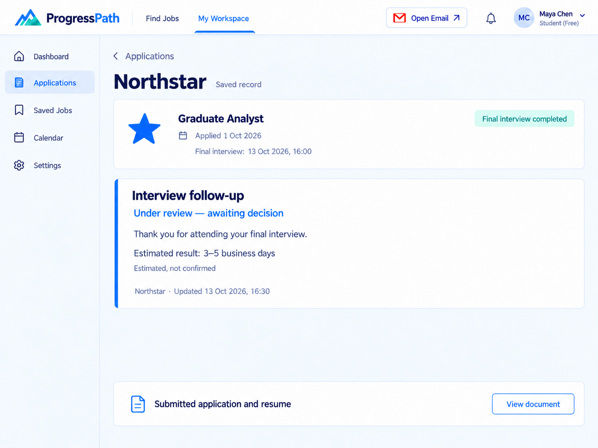
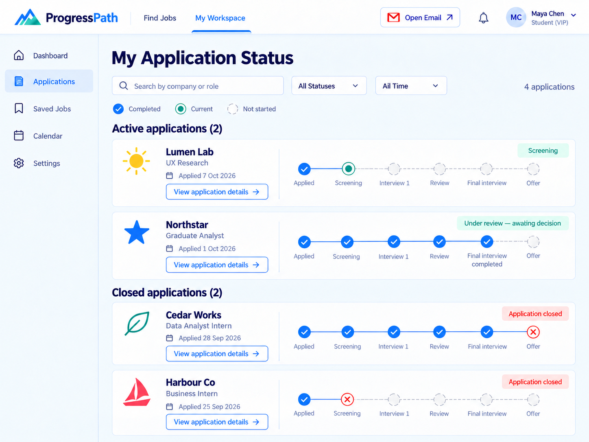
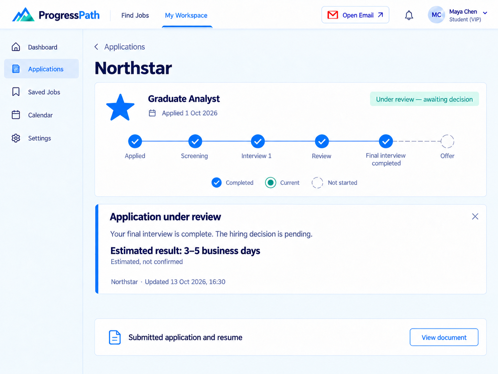
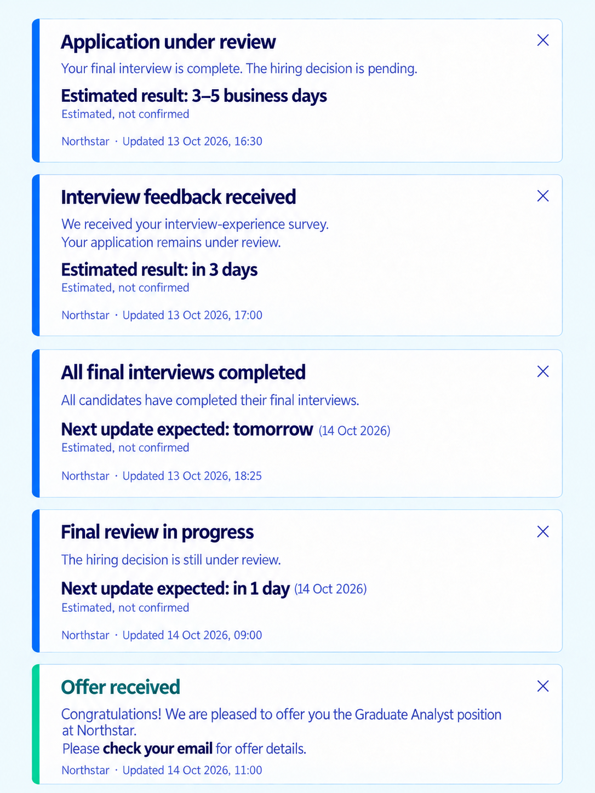
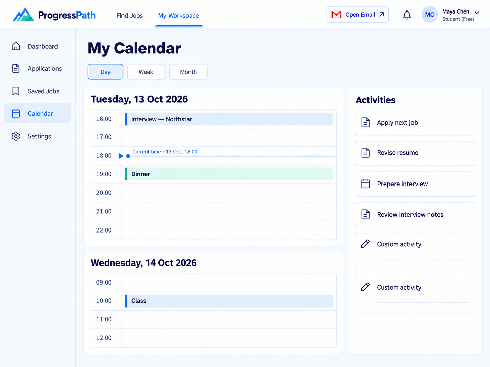

# ProgressPath 最新原型图

本次更新8张原型图，保留上次上传的3张未修改邮件图。以下按原型顺序展示全部最新页面。

A为Free，B为VIP，日历各提供一版。入口为Open Email。POP保留tomorrow和in 1 day的大号粗体，括号日期使用较小常规字体；两处日期均为14 Oct 2026。

| 顺序 | 原型 | 查看图片 |
|---|---|---|
| 01 | 申请文件总览 · Free | [查看](01_A0_Free.png) |
| 02 | 初始跟进记录 · Free | [查看](02_A1_Free.png) |
| 03 | 申请进度总览 · VIP | [查看](03_B0_VIP.png) |
| 04 | 审核中状态 · VIP | [查看](04_B1_1_VIP.png) |
| 05 | 面试体验反馈已收到 · VIP | [查看](05_B1_2_VIP.png) |
| 06 | 五张状态卡 · 最新字体与日期 | [查看](06_POP.png) |
| 07 | 面试评分邮件 · 沿用未修改版本 | [查看](../v2/07_G0_v2.png) |
| 08 | 刷新后暂无新邮件 · 沿用未修改版本 | [查看](../v2/08_G1_v2.png) |
| 09 | 录用邮件 · 沿用未修改版本 | [查看](../v2/09_G_offer_v2.png) |
| 10 | 日历 · Free | [查看](10_Calendar_Free.png) |
| 11 | 日历 · VIP | [查看](11_Calendar_VIP.png) |

## 01 · 申请文件总览 · Free

## 02 · 初始跟进记录 · Free

## 03 · 申请进度总览 · VIP

## 04 · 审核中状态 · VIP

## 05 · 面试体验反馈已收到 · VIP

## 06 · 五张状态卡 · 最新字体与日期

## 07 · 面试评分邮件 · 沿用未修改版本

## 08 · 刷新后暂无新邮件 · 沿用未修改版本

## 09 · 录用邮件 · 沿用未修改版本

## 10 · 日历 · Free

## 11 · 日历 · VIP

