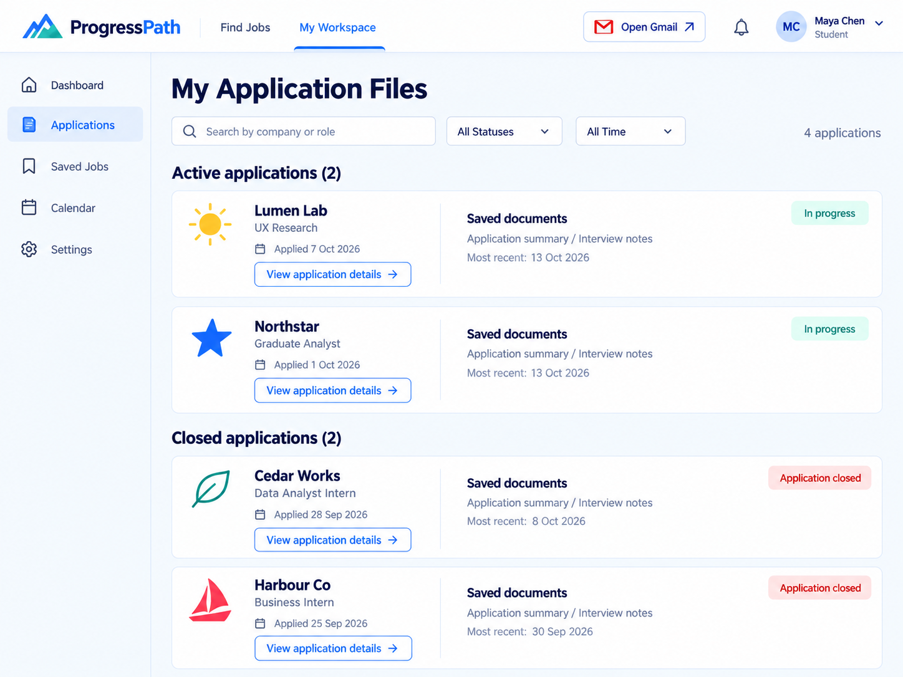
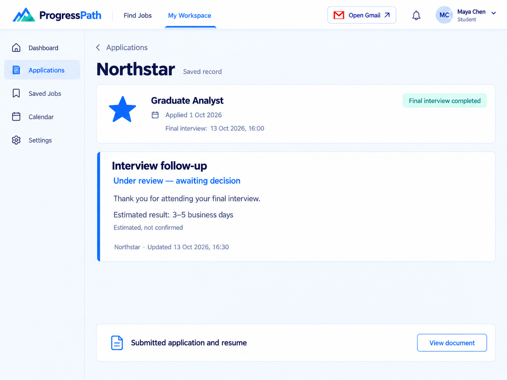
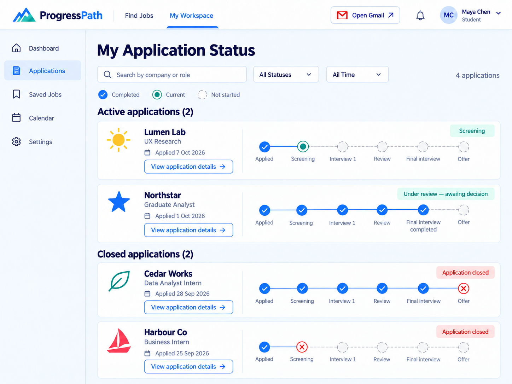
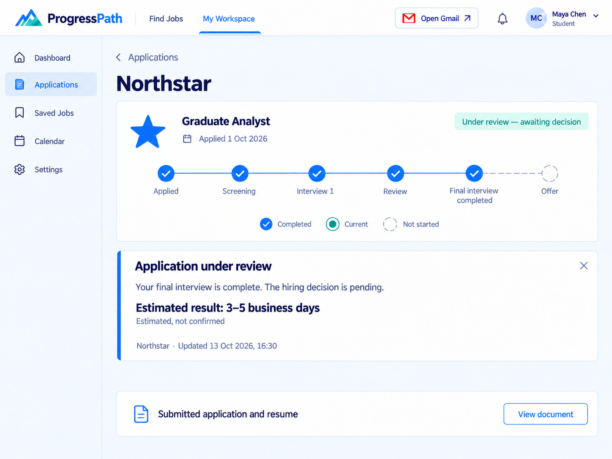
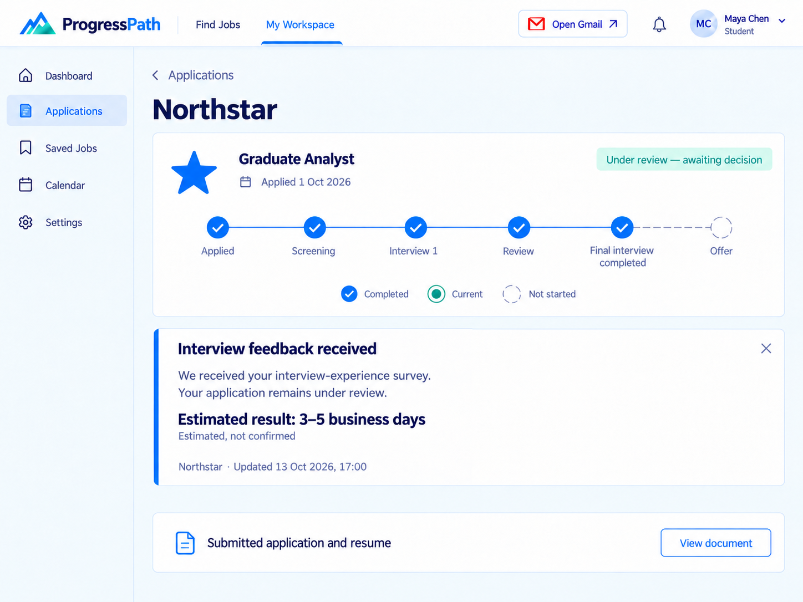
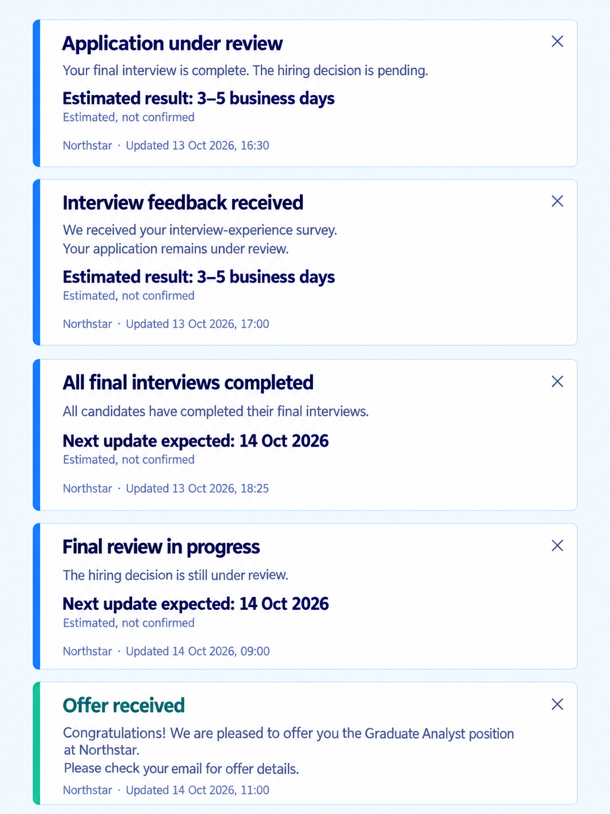
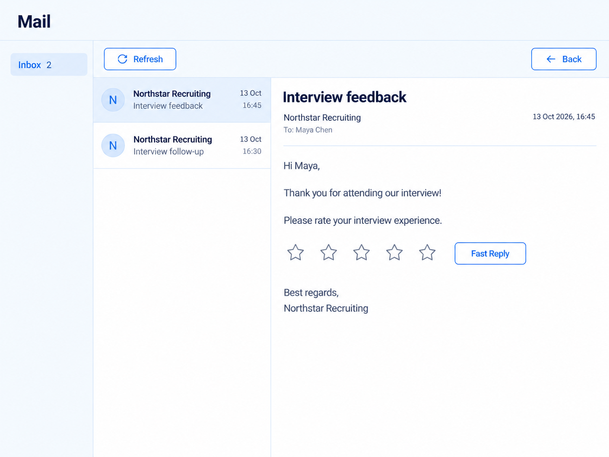
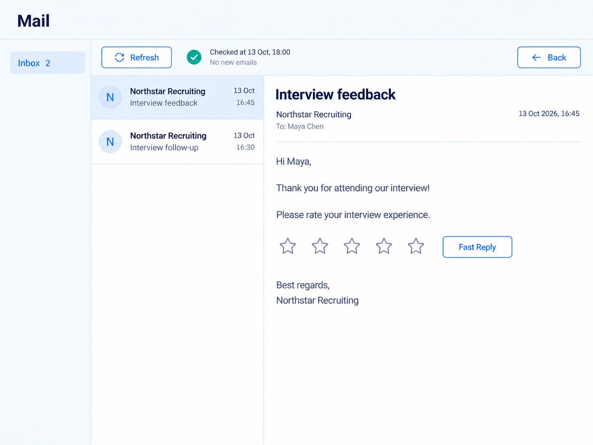
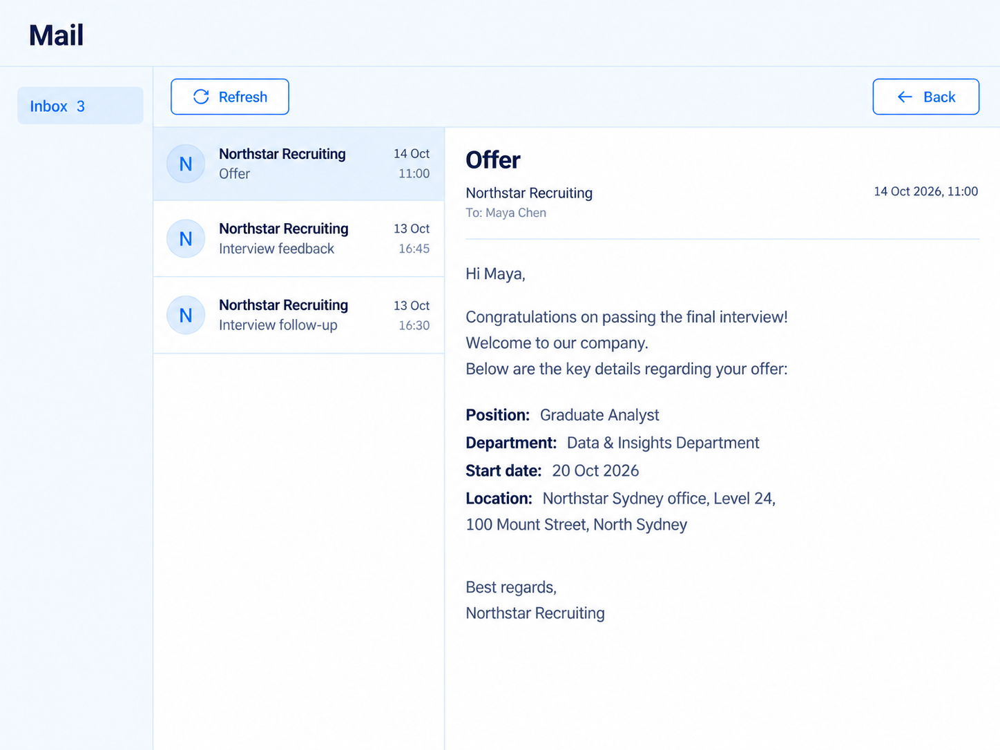
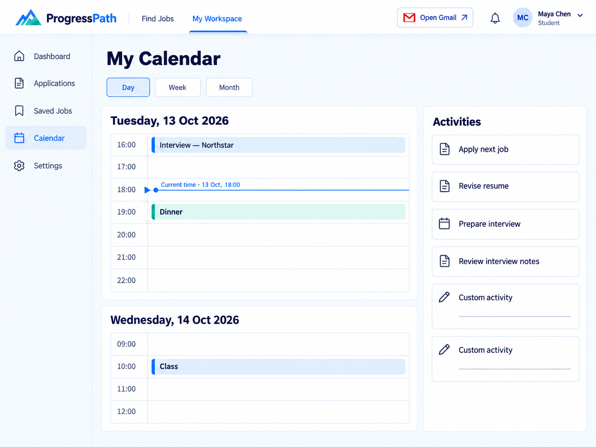

# ProgressPath 原型图 V2

本文件夹按聊天中展示的顺序保存 10 张原型图，与旧版逐一对应。仅落实已确认的六项修改，配色参考用户提供的界面。

| 顺序 | 对应旧图 | 新版图片 |
|---|---|---|
| 01 | A0.jpg | [申请文件总览（A）](01_A0_v2.png) |
| 02 | A1.jpg | [初始跟进记录（A）](02_A1_v2.png) |
| 03 | B0.jpg | [申请进度总览（B）](03_B0_v2.png) |
| 04 | B1_1.jpg | [审核中状态（B）](04_B1_1_v2.png) |
| 05 | B1_2.jpg | [面试体验反馈已收到（B）](05_B1_2_v2.png) |
| 06 | POP.jpg | [五张状态卡材料页](06_POP_v2.png) |
| 07 | G0.jpg | [面试评分邮件](07_G0_v2.png) |
| 08 | G1.jpg | [刷新后暂无新邮件](08_G1_v2.png) |
| 09 | G_offer.jpg | [录用邮件](09_G_offer_v2.png) |
| 10 | Calendar.jpg | [日历与自定义活动](10_Calendar_v2.png) |

## 01 · 申请文件总览（A）

## 02 · 初始跟进记录（A）

## 03 · 申请进度总览（B）

## 04 · 审核中状态（B）

## 05 · 面试体验反馈已收到（B）

## 06 · 五张状态卡材料页

## 07 · 面试评分邮件

## 08 · 刷新后暂无新邮件

## 09 · 录用邮件

## 10 · 日历与自定义活动

