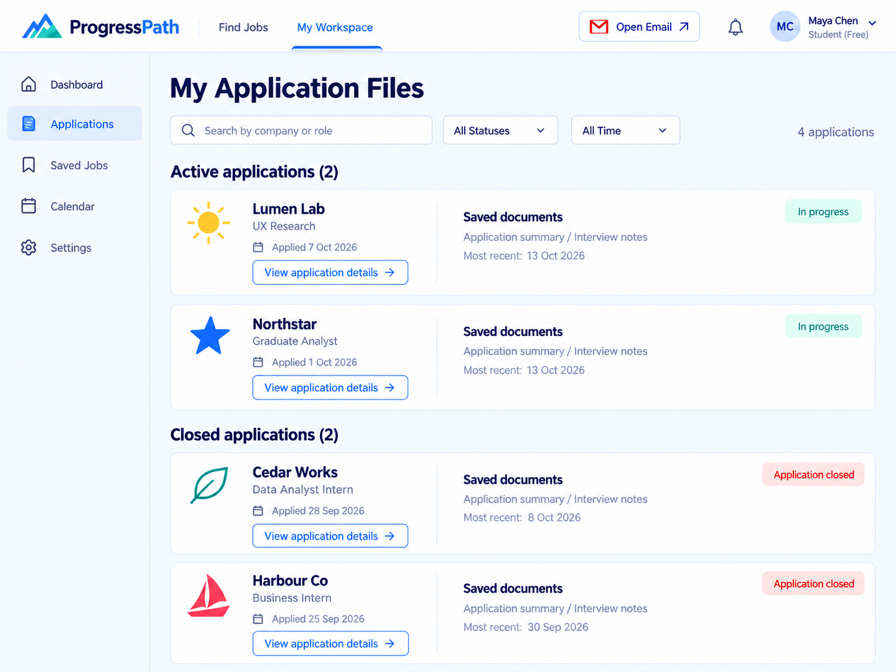
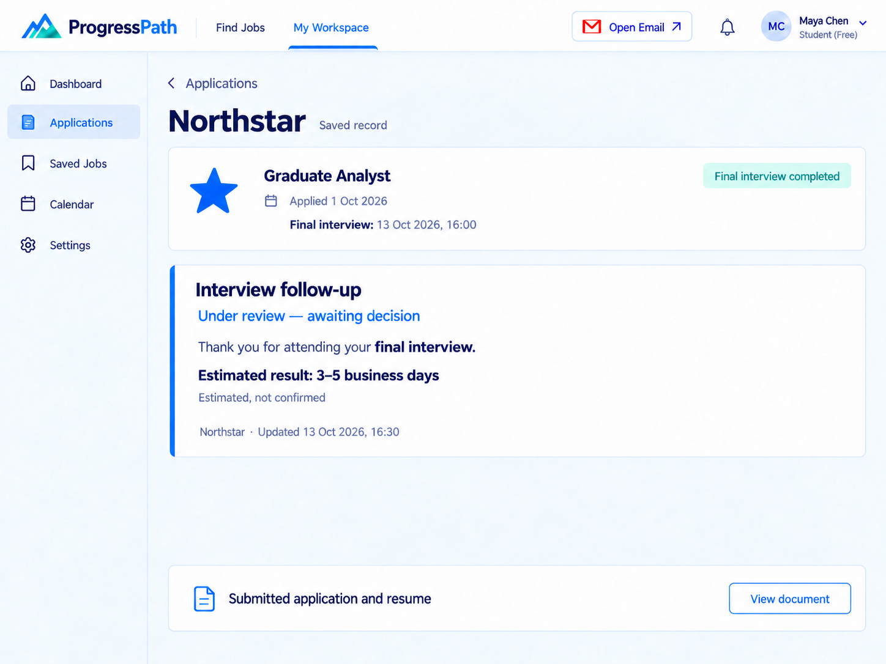
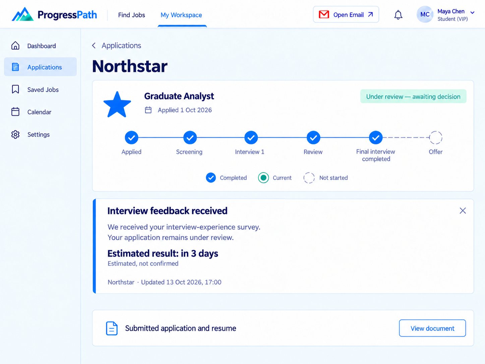
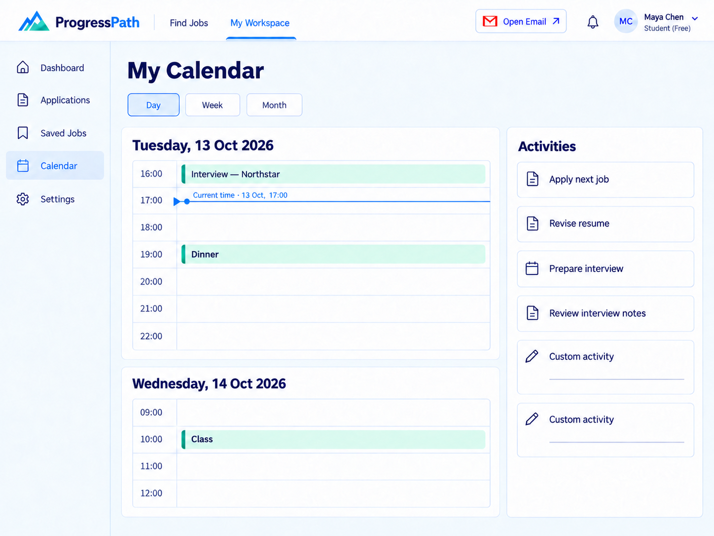
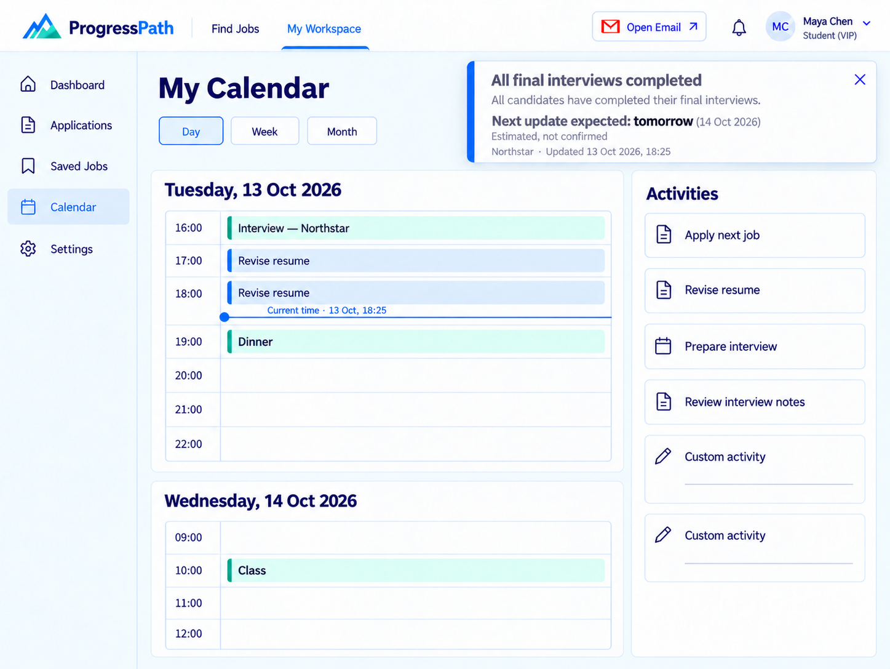
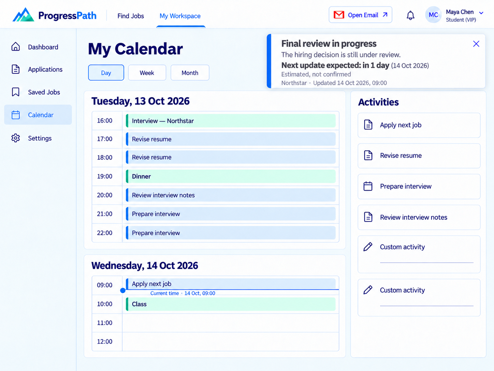
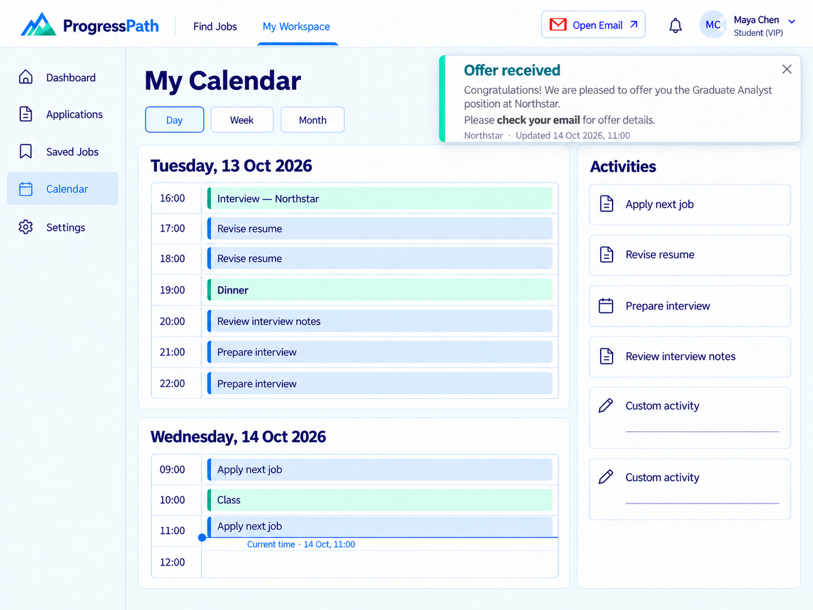

# ProgressPath V4 原型图

目前最新版，共12张原型图，按页面顺序排列。Free与VIP版本均包含在内，VIP日历提供三个测试流程状态。

本版包含Free详情页的指定文字加粗、三张带通知弹窗的VIP日历、保留完整Activities的日历布局，以及最新的日程颜色、弹窗阴影和灰色文字。原有独立06 POP页已从本版移除。

历史版本：[V3（原latest目录）](../v3/README.md) · [V2](../v2/README.md)

| 顺序 | 原型 | 查看图片 |
|---|---|---|
| 01 | 申请文件总览 · Free | [查看](01_A0_Free.png) |
| 02 | 初始跟进记录 · Free | [查看](02_A1_Free.png) |
| 03 | 申请进度总览 · VIP | [查看](03_B0_VIP.png) |
| 04 | 审核中状态 · VIP | [查看](04_B1_1_VIP.png) |
| 05 | 面试体验反馈已收到 · VIP | [查看](05_B1_2_VIP.png) |
| 07 | 面试评分邮件 | [查看](07_G0.png) |
| 08 | 刷新后暂无新邮件 | [查看](08_G1.png) |
| 09 | 录用邮件 | [查看](09_G_offer.png) |
| 10 | 日历 · Free · 13 Oct, 17:00 | [查看](10_Calendar_Free.png) |
| 11a | 日历 · VIP · 13 Oct, 18:25 | [查看](11a_Calendar_VIP_13Oct_1825.png) |
| 11b | 日历 · VIP · 14 Oct, 09:00 | [查看](11b_Calendar_VIP_14Oct_0900.png) |
| 11c | 日历 · VIP · 14 Oct, 11:00 | [查看](11c_Calendar_VIP_14Oct_1100.png) |

## 申请文件总览 · Free

## 初始跟进记录 · Free（指定文字加粗）

## 申请进度总览 · VIP

## 审核中状态 · VIP

## 反馈已收到 · VIP

## 面试评分邮件

## 刷新后暂无新邮件

## 录用邮件

## Free 日历 · 13 Oct, 17:00

## VIP 日历 · 13 Oct, 18:25

## VIP 日历 · 14 Oct, 09:00

## VIP 日历 · 14 Oct, 11:00

